<p align="center">
  
</p>

<h1 align="center">🚀 LaunchPilot</h1>

<p align="center">
  <strong>The Ultimate AI Product-Launch Copilot for Solo Founders, Indie Builders, and Startup Teams.</strong>
  <br />
  Translate rough ideas, features, or messy PRDs into beautiful, launch-ready execution packs in seconds.
</p>

<p align="center">
  
  
  
  
  
</p>

---

## ⚡ What's New in v1.1.0 (Recent Enhancements)

We have recently upgraded LaunchPilot to deliver a premium user experience and fully comply with modern Next.js 15 features:

*   🌐 **Premium Animation System**: Integrated smooth floating ambient particles, dynamic cosmic aurora glow backdrops, 3D card tilt hovers, and glowing gradient borders.
*   ✨ **Feature Landing Strip**: Added an interactive core benefit overview featuring staggered floating icons (`Zap`, `Layers`, `Target`, `Shield`) that animate dynamically.
*   🌓 **Next-Themes & Tailwind v4 Bridge**: Added `@custom-variant dark` support in `globals.css` to link class-based theme injection with Tailwind CSS v4 variables, implementing a smooth transition switch between light and dark modes.
*   🛠️ **React 19 & Next.js 15 App Router Compliance**: Re-engineered page props to serialize event handlers (e.g. `onInsertBriefAction`) as Client Component boundary-compliant Server Actions.
*   ♿ **Full Accessibility (a11y) Upgrades**: Patched icon-only interactive controls with explicit `title` tags, corrected markup headings, and added aria labels to form textareas.
*   🧹 **Zero Inline Styles Refactor**: Moved inline CSS variables (particle positioning, delays, custom colors) to pure utility classes within `src/app/globals.css`.

---

## 🛠️ Technology Stack

| Layer | Technology | Key Role / Rationale |
| :--- | :--- | :--- |
| **Framework** | Next.js 15 (App Router) | High-performance Server Components, routing layout boundaries |
| **Runtime** | React 19 + TypeScript | Direct Server Actions integration, type safety across AI models |
| **Theme Engine** | `next-themes` | Clean CSS variable class toggles without initial render flash |
| **Animations** | `framer-motion` | Staggered grid cards, fade-in-up layout transitions |
| **Styling** | Tailwind CSS v4 | Class-first layout styling, modernized design token integration |
| **Icons** | Lucide React | Clean, scalable vector icon layouts |
| **Telemetry** | Novus.ai | Funnel telemetry logging for brief actions and dashboard exports |

---

## ✨ Core Features

*   🎯 **One-Click Example Briefs**: Pre-packaged sandbox examples (`InsightSum AI`, `RemotelyWiki`, `FlowAnalytics`) let users experience workspace generation instantly.
*   ⚙️ **Granular Launch Configurator**: Tailor plans by matching specific target audiences, schedules (*today*, *this week*, *this month*), and launch goals (*activation*, *retention*, *revenue*).
*   📦 **Structured Output Cards**: AI organizes recommendations into 8 clean sections:
    1.  **Launch Summary**: Elevated core messaging and brand description.
    2.  **User Stories**: Clear agile features mapping targets.
    3.  **Checklist Matrix**: Actions divided by *Pre-Launch*, *Go-Live*, and *Post-Launch* stages.
    4.  **Risks & Mitigation**: A table covering blockers, impact levels, and escape routes.
    5.  **Interactive Demo Script**: Step-by-step narrative guides for showcase videos.
    6.  **Release Notes**: Pre-drafted markdown copy for launch updates.
    7.  **Key Success Metrics**: Quantitative goals to gauge market fit.
    8.  **Feedback Loop**: Curated list of customer research questions.
*   ✏️ **Inline Editing Control**: Every item, metric, and risk in the generated workspace can be updated inline with one click.
*   💾 **Master Markdown Export**: Instantly copy individual cards or download the entire launch brief as a `.md` markdown file for Notion or Slack.
*   🧠 **LLM Endpoints Ready**: Powered by a robust prompt simulator. Connect live `Gemini` or `OpenAI` models instantly using local environment keys.

---

## 📁 Directory Structure

```
launchpilot/
├── public/
│   ├── launchpilot-hero.svg   # Animated dashboard banner image
│   └── ...                    # Static vector resources
├── src/
│   ├── app/
│   │   ├── api/
│   │   │   └── generate/
│   │   │       └── route.ts   # Core AI Generator API (Gemini/OpenAI Router)
│   │   ├── globals.css        # Tailwind v4 variables, light/dark keyframes, animations
│   │   ├── layout.tsx         # SEO configuration, next-themes provider, page container
│   │   └── page.tsx           # Main workspace (Landing view + Workspace UI)
│   ├── components/
│   │   ├── AssistantPanel.tsx # AI sidebar panel with direct action insertions
│   │   ├── ThemeProvider.tsx  # Color mode wrapper
│   │   └── ThemeToggle.tsx    # Premium sun/moon icon switcher
│   └── lib/
│       ├── analytics.ts       # Funnel telemetry utils
│       ├── mock-data.ts       # Fallback mock generators
│       └── types.ts           # Strict data contract interfaces
├── eslint.config.mjs          # Flat-config format eslint adjustments
├── next.config.mjs            # Production compiler configurations
└── package.json               # Package dependencies & run scripts
```

---

## ⚡ Getting Started

### 1. Install Dependencies

Ensure you have Node.js (v18+) installed. Clone the project and install:

```bash
npm install
```

### 2. Configure API Keys (Optional)

By default, the application runs on high-fidelity offline mock parameters. To connect to active AI endpoints, create an `.env.local` file in the root directory:

```env
# For Gemini Generation (Recommended / Rapid Response)
GEMINI_API_KEY=your_gemini_api_key_here

# For OpenAI Generation
OPENAI_API_KEY=your_openai_api_key_here
```

### 3. Spin Up the Local Server

```bash
npm run dev
```

Open [http://localhost:3000](http://localhost:3000) inside your web browser.

> [!TIP]
> Use the **Theme Toggle** button in the upper-right corner to test the transition animation between dark mode (cosmic dark) and light mode (pristine light).

---

## 📄 License

Distributed under the MIT License. See `LICENSE` for more information.

---
<p align="center">
  <sub>Built with ❤️ by Solo Founders for Solo Founders</sub>
</p>
